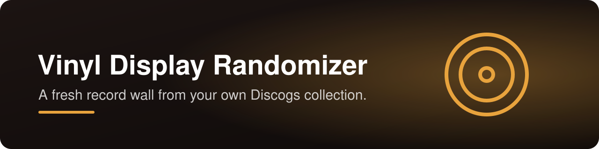
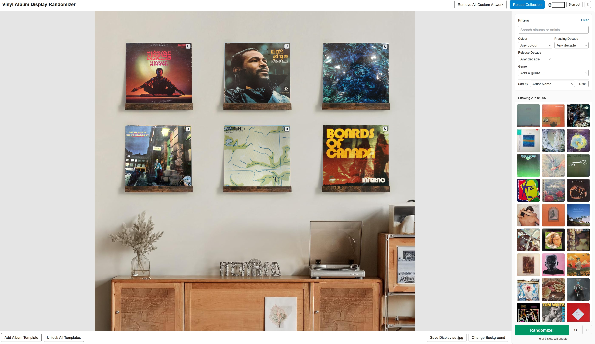

<p align="center">
  
</p>

<p align="center">
  <a href="https://randomvinyl.com"></a>
  
</p>

---

### Got a wall of record frames and can never decide what to put up next?

**Let the randomizer pick.** Take a photo of your shelf or wall, mark where each record goes, and sign in with your Discogs account. One click fills every spot with a random cover from your own collection. Like one? Lock it, and only the rest change next time.

When the wall looks right, save it as a picture, then go and swap the real records.



## ✨ What you get

| | |
|---|---|
| 🖼️ **Your real wall** | Upload a photo of your shelf or frames and draw a slot over each spot. Move and resize them any time. |
| 🎲 **One-click shuffle** | **Randomize!** fills every unlocked slot with a cover from your collection. |
| 🔒 **Keep the keepers** | Lock a slot and its record stays put while everything else shuffles. |
| 🎨 **Filters** | Narrow the pick by cover colour, pressing decade, original release decade or genre, so a wall can be all blue, all '70s or all jazz. |
| 💾 **Save the result** | Download the finished wall as a JPG. |
| 🧠 **Remembers your setup** | Your photo, slots and locks are still there next time you open it. |

## ▶️ Use it

1. Go to **[randomvinyl.com](https://randomvinyl.com)**.
2. Click **Upload Background Image** and pick a photo of your shelf or wall.
3. Drag on the picture to draw a slot for each record, or use **Add Album Template** for a ready-sized one. The **L/U** badge in a slot's corner locks and unlocks it.
4. Click **Sign in with Discogs** and approve, then **Load Collection**. Your records appear on the right.
5. Pick any filters, then hit **Randomize!** as many times as you like.
6. Click **Save Display as .jpg** to keep it.

> [!TIP]
> Cover colours are worked out in the background after your collection loads, so the Colour filter fills in over a minute or two on a big collection.

## ❓ FAQ

<details>
<summary><b>Do I need a Discogs account?</b></summary>

Yes. The records come from your Discogs collection, so you sign in with Discogs. The site only reads your collection; it never changes anything on your account.
</details>

<details>
<summary><b>Where is my wall photo kept?</b></summary>

In your own browser. Your photo, slots and locks are saved on your device, not uploaded anywhere.
</details>

<details>
<summary><b>Why does "release decade" take a while?</b></summary>

Discogs lists each record's pressing year. The year the album first came out lives on a separate page per album, and Discogs only allows about one request a second, so the site fetches those slowly the first time and remembers them after.
</details>

## 🛠️ For developers

<details>
<summary>How it works, and how to run it yourself</summary>

- Next.js (App Router) and TypeScript, Tailwind CSS, Konva for the canvas, Zustand for state (saved to `localStorage`), and Discogs OAuth 1.0a with `iron-session` for sign-in. Cover colours come from `node-vibrant`.
- Covers are fetched through `/api/discogs/image` so the canvas can be saved as an image.
- Only the collection's "All" folder is loaded (`src/lib/discogs.ts`).

**Run it locally**

1. Register an app at [discogs.com/settings/developers](https://www.discogs.com/settings/developers) with the callback `http://localhost:3000/api/auth/callback`.
2. Create `.env.local` at the repo root with these names: `DISCOGS_CONSUMER_KEY`, `DISCOGS_CONSUMER_SECRET`, `DISCOGS_CALLBACK_URL`, `DISCOGS_USER_AGENT` and `SESSION_PASSWORD` (any random string of 32+ characters). `SPOTIFY_CLIENT_ID` and `SPOTIFY_CLIENT_SECRET` are only needed for the Spotify year lookup.
3. `npm install`, then `npm run dev`, and open http://localhost:3000.

**Layout**

```
src/
├── app/api/auth/       Discogs sign-in (request, callback, me, logout)
├── app/api/discogs/    collection, release, master and image proxy
├── app/api/spotify/    year lookup
├── components/         the canvas, filters, collection list, toolbar
├── lib/                OAuth, Discogs fetches, colours, filters, session
└── store/              the app's state
```
</details>

---

<sub>This is an independent project and is not affiliated with or endorsed by Discogs. Album covers belong to their owners.</sub>
